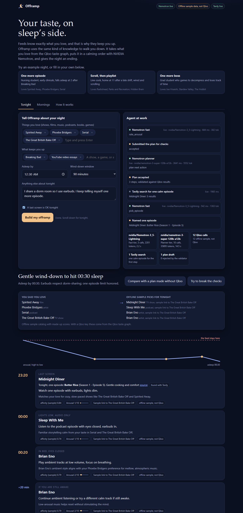
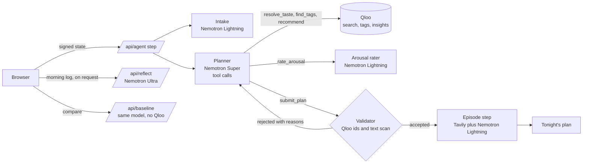

# Offramp

**A bedtime agent that puts your taste on sleep's side.**

Feeds know exactly what you love, and that is why they keep you up. Offramp uses the same kind of knowledge to walk you down. It takes what you love from the Qloo taste graph, puts it in a calming order with NVIDIA Nemotron models on Nebius Token Factory, and gives the night an ending.

Live demo https://offramp-green.vercel.app . Video [VIDEO_URL] . Built for the Qloo Agentic Hackathon and the Nebius x NVIDIA Global AI Hackathon (Best Apps and Agents track).



## Measured

Measured 2026-10-29 (22:38 UTC) with `npm run bench -- --agreement`, 30 runs (3 example nights × 10). Nemotron live, Qloo sample data (no Qloo key yet), Tavily live.

| Measure | Value |
| --- | --- |
| Plans produced | 30 |
| First draft accepted by the validator | 87% |
| Drafts the validator sent back | 4 |
| Made-up titles or ids caught | 4 |
| Plans finished by the safety net | 0% |
| Planner turns with native tool calls | 100% |
| Planner turns on the JSON tool protocol | 0% |
| Arousal ratings made by the model | 78% |
| Calls cut off at max_tokens | 0 |
| Tool calls deferred to stay in the time limit | 0 |
| Median seconds per plan | 26.6 |
| Cost per plan, USD | 0.01376 |

| Tier | Model | Calls per plan | Median ms per call | Tokens per plan | Reasoning tokens per plan |
| --- | --- | --- | --- | --- | --- |
| fast | nvidia/Nemotron-3_5-Lightning | 3 | 863 | 2261 | 23 |
| planner | nvidia/nemotron-3-super-120b-a12b | 10.6 | 1679 | 38162 | 2392 |

Arousal agreement on 11 candidates, fast vs deep. Mean difference 0.64 points, within 1 point 100%, Spearman 0.97. Fast took 3.7 s, deep took 11.2 s.

## The problem

In 2017 Netflix's then CEO Reed Hastings said the company was competing with sleep. Streaming, short video and games are built to know your taste and to never end. The research names both halves of the problem.

| Finding | Source | What Offramp does about it |
| --- | --- | --- |
| Binge viewing was linked to poorer sleep, more fatigue and more insomnia symptoms in 423 adults aged 18 to 25, and cognitive pre-sleep arousal fully mediated the link | Exelmans and Van den Bulck, J Clin Sleep Med 2017, [doi 10.5664/jcsm.6704](https://doi.org/10.5664/jcsm.6704) | Every candidate gets an arousal score, and the plan has to go down step by step |
| Bedtime procrastination, going to bed later than intended with nothing external stopping you, is linked to insufficient sleep | Kroese et al., Front Psychol 2014, [doi 10.3389/fpsyg.2014.00611](https://doi.org/10.3389/fpsyg.2014.00611) | Every step has a clear end, and there is no feed or autoplay in the plan |
| Getting out of bed when sleep does not come keeps the bed linked with sleep (stimulus control, a standard part of CBT-I) | CBT-I | An if-you-are-still-awake step with a book you would like |

Generic sleep advice says "read a book" or "listen to calm music". Which book? Which music? Advice that is not yours is easy to ignore, and the feed is never generic. Offramp keeps the part of the feed that works (it knows you) and removes the part that hurts (it never ends and it keeps escalating).

Why not just rewatch a favorite? Because many favorites are exactly what keeps people up (high suspense, no end), and most of them have no audio-only form for the last half hour in bed. Qloo carries the same taste across domains, from films and TV to podcasts, artists and books, which is the part a sleep plan needs.

## What it does

1. You name a few things you love and what keeps you up (a show, a game, or a habit like TikTok), plus when you want to be asleep.
2. The agent resolves your taste in Qloo, finds calm tags, and asks Qloo for taste-matched candidates in four lanes (last screen, audio, music in bed, a book for if you are awake).
3. It runs a **trap radar**, a Qloo call without the calm filter, to find the high-affinity titles most likely to keep you up tonight. Those go into "Skip tonight, save for daytime".
4. A fast Nemotron model rates each candidate for pre-sleep arousal.
5. The planner model (Nemotron 3 Super, tool calling) builds a timeline that ends in audio only. A validator checks the draft. Every step needs an entity id that Qloo returned in this run, the step text is scanned for quoted or capitalized titles Qloo did not return, and screens must start at least 45 minutes before sleep. A failing draft goes back to the planner with the reasons.
6. With a Tavily key, one more step searches the web for a single calm episode of the first show or podcast. A fast Nemotron model picks one, and the pick is kept only if its title appears word for word in the search results. The first step then has a clear end.
7. In the morning you log how it went (it stays in your browser). After a few nights, Nemotron 3 Ultra reads the week and adjusts tomorrow's plan, which you can apply with one click.
8. A compare button asks the same Nemotron model for a plan without Qloo and counts what each side did (titles tied to a Qloo id, titles new to you, whether it repeats your favorites or recommends what keeps you up, arousal rating, formats). The counts come from the two outputs, not from assumptions.
9. A **Try to break the checks** button hands the validator tonight's plan plus three drafts broken on purpose (an id the model made up, a real id whose text slips in a song from memory, and the thing you said keeps you up five minutes before sleep), so you can watch the code reject them.

## How Qloo is used

| Endpoint | Why |
| --- | --- |
| `GET /search` | Resolve the favorites and traps the person typed into Qloo entity ids, restricted to the right entity type |
| `GET /v2/tags` | Find real tag ids for calm words (relaxing, sleep, ambient, cozy) inside each entity type, instead of guessing ids |
| `GET /v2/insights` with `signal.interests.entities`, `filter.tags`, `filter.exclude.entities` and `feature.explainability` | Taste-matched candidates per lane, the affinity score, and which of your favorites each pick comes from (shown as "Because you like ...") |
| `GET /v2/insights` without tags (trap radar) | The titles Qloo predicts you would love most, used in reverse as the list to save for daytime |

Three design choices make Qloo necessary rather than decorative.

* **Grounding.** Every step must carry an entity id that came back from a Qloo call in the same run, and the step text is scanned for titles Qloo did not return. The scan looks for quoted and capitalized names, so the page always shows each step's title from Qloo data rather than from the model's text.
* **Taste across domains.** The person usually names films and TV. Qloo turns that taste into podcasts, artists and books, the formats that let the night end with eyes closed.
* **Taste used in both directions.** High affinity plus low arousal goes into the plan. High affinity plus high arousal is the trap radar.

Every Qloo call appears in the Agent at work panel with its endpoint, parameters, latency, result count and source.

The client is careful with the API. A 400 is retried at most once per fix, and each fix is written into the trace (drop the optional `bias.trends` and `feature.explainability`, try the other spelling of the video game type, or search without the `types` filter and filter locally). Ids from the offline sample catalog never reach the live API.

`data/sample-qloo.json` is a hand-made sample catalog, not data from the Qloo API. The titles are real, but every id, tag, score and description in it was written by hand for offline use.

## How NVIDIA Nemotron on Nebius Token Factory is used

Offramp routes each job to the smallest model that does it well, as the Best Apps and Agents track suggests.

| Tier | Default model on Token Factory | Job |
| --- | --- | --- |
| Fast | `nvidia/Nemotron-3_5-Lightning` | Intake parsing, arousal rating for up to 30 candidates per call |
| Planner | `nvidia/nemotron-3-super-120b-a12b` | Tool-calling agent loop that decides which Qloo calls to make and drafts the plan |
| Deep | `nvidia/Nemotron-3-Ultra-550b-a55b` | Weekly reflection over the morning log |

All calls go to the OpenAI-compatible Token Factory API at runtime. The UI shows each model id, latency and token count, and the run summary adds up calls, tokens and seconds per tier, plus how many drafts the validator sent back.

Failure handling, each covered by a test against a local fake Token Factory server.

| Situation | What Offramp does |
| --- | --- |
| The planner returns no native tool calls | Switches to a JSON tool protocol and says so in the trace |
| A reasoning model spends `max_tokens` thinking and returns nothing | Retries once with twice the budget, counts the billed tokens, and notes it in the trace |
| A call would run past the serverless time limit | Each step has a time budget (`OFFRAMP_STEP_BUDGET_MS`, 52 s by default). Calls that would not fit are handed back to the planner for its next turn |
| Token Factory is unreachable or out of credits | The next step runs the fixed tool sequence on the same Qloo data, and the page says the planner model could not be reached |
| The planner runs out of steps or is rejected three times | A deterministic planner assembles the plan from the same Qloo results and says so |

`npm run bench` measures all of this on live keys. It reports first-draft acceptance, drafts sent back, made-up titles caught, native tool calls versus the JSON protocol, median latency and tokens per tier, cost per plan (with your prices), and with `--agreement` how closely the fast and deep models agree on arousal.

## Architecture



The agent is a stateless step function. The browser calls `/api/agent` once to start and once per planner step. Each step is one planner turn plus the tools it called, inside a time budget, so no serverless request runs past the limit and the UI can show the agent working live. The state travels with an HMAC signature, so it cannot be edited in the browser to misuse the model keys.

## Run it

Requires Node 20 or newer. No packages to install.

```bash
npm start            # http://localhost:5174, works with no keys (mock model, sample taste data)
npm test             # 35 offline tests, including fake Token Factory, Qloo and Tavily servers
npm run smoke        # runs the three example nights end to end in the terminal
```

To use the real services, copy `.env.example` to `.env` and add keys.

```bash
cp .env.example .env     # then fill in NEBIUS_API_KEY and QLOO_API_KEY
npm run check-keys       # one tiny call per service, prints status and model ids, never the keys
npm start
npm run bench            # measured numbers for the write-up (aggregates only, saved to bench/, gitignored)
npm run shot             # retakes docs/screenshot.png from the running app
```

After deploying, check the public URL the way a judge would.

```bash
npm run check-live -- https://your-app.vercel.app
```

### Deploy

The repo deploys to Vercel as is (static `public/` plus functions in `api/`). Add `NEBIUS_API_KEY`, `QLOO_API_KEY`, `OFFRAMP_STATE_SECRET` and optionally `TAVILY_API_KEY` as environment variables in the Vercel project.

Optional settings.

| Variable | Use |
| --- | --- |
| `QLOO_SNAPSHOTS_GZ_B64` | The private Qloo cache made by `npm run record` (the one line in `qloo-snapshots.env.local.txt`). Keeps the example nights on real Qloo data after hackathon keys are switched off |
| `QLOO_VIDEOGAME_TYPE` | Pin the video game type spelling if `npm run check-keys` shows only one works (`urn:entity:video_game` or `urn:entity:videogame`) |
| `NEBIUS_MODEL_FAST`, `NEBIUS_MODEL_PLANNER`, `NEBIUS_MODEL_DEEP` | Other Nemotron model ids, if your Token Factory account lists different ones |
| `NEBIUS_EXTRA_BODY` | Extra JSON merged into every chat request, for example to turn a model's reasoning mode off |
| `NEBIUS_TIMEOUT_MS`, `OFFRAMP_STEP_BUDGET_MS` | Per call timeout (40 s) and per step budget (52 s). Keep the budget under the `maxDuration` in `vercel.json` |
| `TAVILY_API_KEY` | Turns on the episode step |

## Honest labels

Every piece of data says where it came from.

| Label | Meaning |
| --- | --- |
| Qloo live | A real call to the Qloo API during this run |
| Qloo recorded | A real Qloo response recorded earlier with `npm run record`. Qloo turns hackathon keys off after its judging period, so the deployed demo keeps real Qloo data for the example nights after that. Following Qloo's guide, this cache is private server-side data. It is gitignored and never committed, and the hosted copy lives in an environment variable |
| offline sample, not Qloo | The offline catalog in `data/sample-qloo.json`. Real titles, but made-up ids, scores and links. The page labels its scores "affinity (sample)" |
| found with Tavily | An episode title that appeared in a Tavily web search result during this run |
| Nemotron live or mock | A real Token Factory call, or the deterministic offline stand-in used in tests |

## Privacy and safety

* The server stores nothing. The morning log lives in your browser's storage and is sent to the model only when you press Reflect.
* Text that suggests a crisis pauses the run and shows the 988 Suicide and Crisis Lifeline instead of a plan.
* Text that suggests long-term insomnia adds a note to talk to a clinician about CBT-I.
* Offramp is a wellness tool, not medical care.

## Repository map

| Path | What is inside |
| --- | --- |
| `lib/agent.js` | Step function, tool loop, fallbacks, state signing |
| `lib/tools.js` | Tool schemas and executors |
| `lib/qloo.js` | Qloo client with live, recorded and sample sources |
| `lib/llm.js` | Token Factory client and JSON extraction |
| `lib/plan.js` | Validator (ids and text scan), timeline math, deterministic planner |
| `lib/tavily.js` | Episode search and the check that the pick appears in the results |
| `lib/prompts.js` | All prompts in one place |
| `api/` | Vercel functions |
| `public/` | The web app, no build step |
| `scripts/` | Key check, live check, benchmark, snapshot recorder, screenshot |
| `test/` | Offline tests |

## Built during the hackathons

Offramp was started from scratch on October 28, 2026, for these two hackathons. It did not exist before either submission period. I built it with help from an AI coding assistant (Claude Code).

## License

MIT, see [LICENSE](LICENSE).
